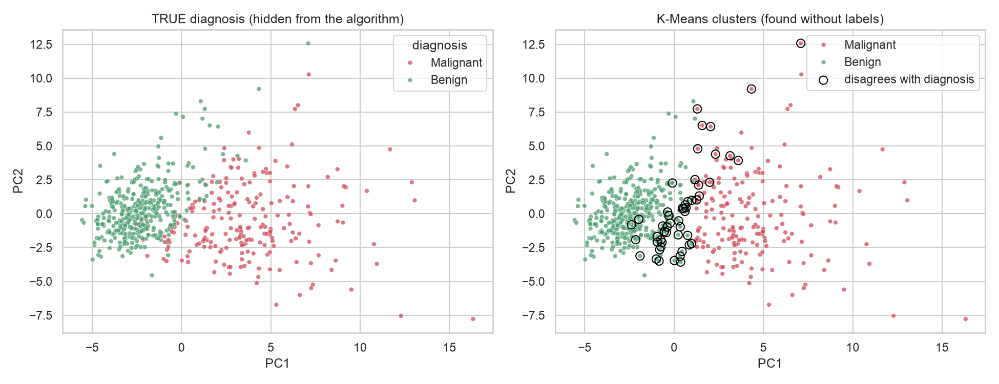
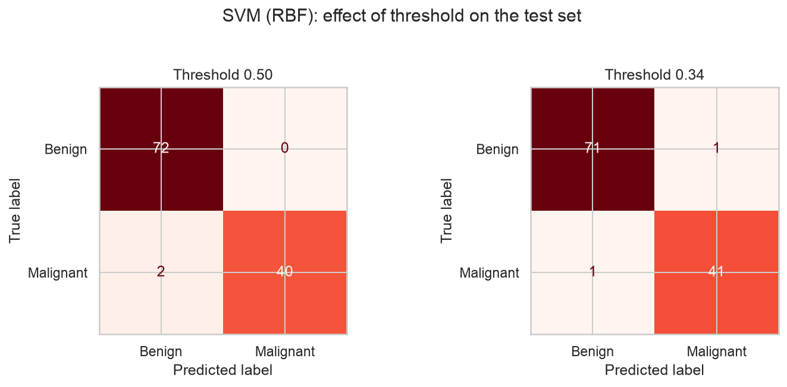
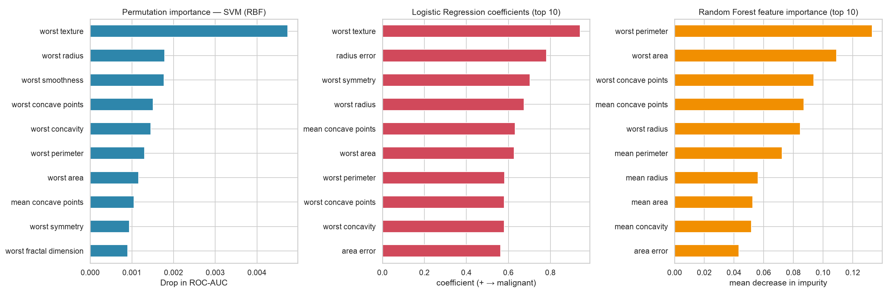

# Benign or Malignant? Breast Tumour Diagnosis with Supervised and Unsupervised Learning

Machine Learning Lab small project. One medical dataset, two programs:

1. **Supervised:** learn the diagnosis from labelled patients and test it on patients the model has never seen.
2. **Unsupervised:** hide the labels and check whether the data splits into benign and malignant groups on its own.

**Live demo:** https://tumour-ml.vercel.app

Pick one of the 114 test patients or move the measurements, and the page shows the SVM's prediction and the
K-Means group for that patient. Test patients 17 and 19 are the two the model gets wrong.

| | |
|---|---|
| **Supervised (tuned RBF-SVM)** | 98.2% accuracy, 97.6% recall, ROC-AUC 0.997, 1 of 42 cancers missed on the test set |
| **Unsupervised (K-Means on PCA)** | Agrees with the hidden diagnosis for 91.0% of patients, ARI 0.67 |



## Team

| Member | USN | Part | Notebook |
|---|---|---|---|
| K Aditya Raj Kumar Dora | 240101230 | Dataset, data quality, EDA, train/test split | [`01_data_and_eda.ipynb`](01_data_and_eda.ipynb) |
| Atyadik Kumar Anand | 241010251 | Program 1: supervised learning | [`02_supervised_learning.ipynb`](02_supervised_learning.ipynb) |
| Naman Singh | 240101219 | Program 2: unsupervised learning | [`03_unsupervised_learning.ipynb`](03_unsupervised_learning.ipynb) |

## Dataset

**Breast Cancer Wisconsin (Diagnostic)**, UCI Machine Learning Repository.

- 569 patients: 357 benign (62.7%), 212 malignant (37.3%)
- 30 numeric features: 10 measurements of the cell nuclei in a biopsy image (radius, texture, perimeter, area,
  smoothness, compactness, concavity, concave points, symmetry, fractal dimension), each recorded as mean,
  standard error and worst
- No missing or duplicate values
- Bundled with scikit-learn (`sklearn.datasets.load_breast_cancer`), so nothing has to be downloaded

## What the EDA showed

- Feature scales differ a lot (area reaches about 2500, smoothness is about 0.1), so every model standardises first.
- Radius, perimeter and area are almost perfectly correlated (r ≈ 0.99); 21 feature pairs have |r| > 0.9.
- Worst concave points is the strongest single indicator of malignancy (r = 0.79).
- 67% of rows with an IQR outlier are malignant. They are real large tumours, so they were kept.
- One stratified 80/20 split (455 train / 114 test) is shared by both programs. The test set is used once.

## Program 1: Supervised learning

Every model is a `Pipeline(StandardScaler → classifier)`, so the scaler is fitted on training folds only.

1. Compare 7 algorithms with 5-fold stratified cross-validation.
2. Tune the best three with `GridSearchCV` (scored by F1).
3. Pick the final model by cross-validated F1, before the test set is opened.
4. Tune the decision threshold on training folds so that recall is at least 98%.
5. Evaluate once on the 114 held-out patients.

| Model (tuned) | Accuracy | Precision | Recall | F1 | ROC-AUC | Missed cancers |
|---|---|---|---|---|---|---|
| **SVM (RBF), threshold 0.34 (final)** | **98.2%** | **97.6%** | **97.6%** | **0.976** | **0.997** | **1 of 42** |
| SVM (RBF), threshold 0.50 | 98.2% | 100% | 95.2% | 0.976 | 0.997 | 2 of 42 |
| Logistic Regression | 98.2% | 97.6% | 97.6% | 0.976 | 0.997 | 1 of 42 |
| Random Forest | 95.6% | 100% | 88.1% | 0.937 | 0.994 | 5 of 42 |

Missing a cancer is worse than a false alarm, so the threshold was lowered from 0.50 to 0.34. That trades one
false alarm for one fewer missed cancer.



The features the models rely on are the "worst" size and shape measurements: the largest, most irregular nuclei.



## Program 2: Unsupervised learning

The diagnosis column is removed. Labels come back only at the end, to grade the clusters.

- **PCA:** 7 of 30 components keep 90% of the variance. PC1 alone explains 44%.
- **Choosing k:** the silhouette score peaks at k = 2, without using any labels.

| Method | Clusters | Silhouette | ARI | NMI | Agreement with diagnosis |
|---|---|---|---|---|---|
| **K-Means** | 2 | **0.371** | **0.671** | **0.555** | **91.0%** |
| Agglomerative (Ward) | 2 | 0.347 | 0.666 | 0.543 | 90.9% |
| Gaussian Mixture | 2 | 0.310 | 0.485 | 0.375 | 84.9% |
| DBSCAN | 1 + 36 noise | n/a | 0.049 | 0.038 | n/a |

- The malignant-like cluster has about 2× the nucleus area and 4× the concavity of the benign-like cluster.
- DBSCAN cannot split the classes because there is no low-density gap between them. Its noise points are 72%
  malignant, so it works as an outlier detector instead.

## Supervised vs unsupervised

| Approach | Accuracy | Malignant recall |
|---|---|---|
| K-Means, no labels | 91.0% | 82.5% |
| Ward, no labels | 90.9% | 88.7% |
| **SVM, with labels (test set)** | **98.2%** | **97.6%** |

Clustering recovers most of the structure with no labels at all. Labels cut the error rate from 9.0% to 1.8%,
and the gain is on the borderline tumours where the two groups overlap.

## Web app

The [`webapp/`](webapp) folder is a small site deployed on Vercel.

- **Backend:** `api/predict.py` is a Python serverless function. `POST /api/predict` with `{"features": [30 numbers]}`
  returns the malignant probability, the verdict at the tuned threshold, the K-Means cluster and the patient's
  position on the first two principal components.
- **No scikit-learn at runtime:** `export_model.py` writes the trained SVM (scaler, support vectors, coefficients,
  probability calibration) and the PCA + K-Means parameters to `api/model.json`. The function redoes the maths in
  plain Python, and the export script checks that it matches scikit-learn on every test patient (largest
  difference about 1e-14).
- **Frontend:** `index.html` is a single static page with no build step.

Run it locally with only the Python standard library:

```bash
python webapp/dev_server.py
```

Then open http://localhost:8000. After retraining, refresh the exported model with `python webapp/export_model.py`.

## Repository layout

```
├── 01_data_and_eda.ipynb           dataset, data quality, EDA, train/test split
├── 02_supervised_learning.ipynb    Program 1
├── 03_unsupervised_learning.ipynb  Program 2
├── html/                           the notebooks as HTML (open in any browser)
├── data/                           breast_cancer.csv, train.csv, test.csv
├── figures/                        every plot as PNG
├── results/                        every results table as CSV
├── models/final_model.joblib       the final SVM and its threshold
├── webapp/                         live demo: static page + Python prediction API
├── REPORT.md                       project report
├── VIVA_GUIDE.md                   what each member explains, with likely questions
└── requirements.txt
```

## Run it

```bash
python3 -m venv .venv && source .venv/bin/activate
pip install -r requirements.txt
jupyter notebook
```

Run the notebooks in order (01 → 02 → 03) with *Kernel → Restart & Run All*. Notebook 01 writes the data files
the other two read. Every random step uses `random_state = 42`, so the numbers reproduce.

To run everything from the terminal:

```bash
for nb in 01_data_and_eda 02_supervised_learning 03_unsupervised_learning; do
  jupyter nbconvert --to notebook --execute --inplace $nb.ipynb
done
```

## Limitations

- 569 patients from one centre. The model would need validation on other hospitals' data.
- It is a decision-support tool for study purposes, not a diagnostic device.

## References

1. W. H. Wolberg, W. N. Street, O. L. Mangasarian. *Breast Cancer Wisconsin (Diagnostic)*. UCI Machine Learning Repository, 1995.
2. F. Pedregosa et al. "Scikit-learn: Machine Learning in Python." *JMLR* 12, 2011.
